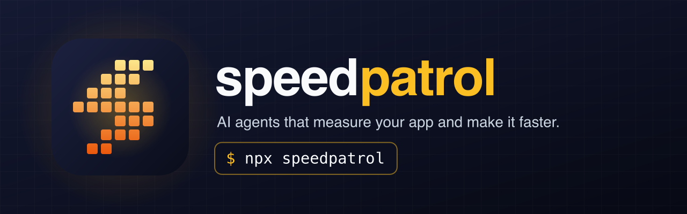
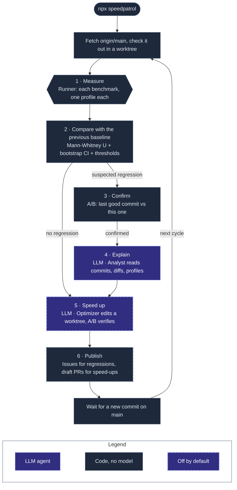

<p align="center">
  
</p>

<p align="center">
  <a href="https://www.npmjs.com/package/speedpatrol"></a>
  <a href="https://github.com/agent-labs-dev/speedpatrol/actions/workflows/ci.yml"></a>
  <a href="LICENSE"></a>
</p>

Speedpatrol is a performance team made of agents. It measures the critical paths of your app on each commit to `main`: API endpoints, app open, page loads, screen navigation, builds, and commands. It keeps a baseline of each run, finds regressions with statistics, explains them, and proposes speed-ups that it measured itself. It is the performance sibling of [Bugpatrol](https://github.com/agent-labs-dev/bugpatrol).

- The **scout** agent reads the repo and the app, finds the critical paths, and writes a benchmark for each one.
- The **runner** is code, not a model. It starts the app, measures each benchmark, and records the **baseline** of the commit.
- **Statistics** decide each verdict. A second A/B measurement must confirm each regression.
- The **analyst** agent explains each confirmed regression: the suspect commits, the code, and the CPU profile.
- The **optimizer** agent (off by default) tries a speed-up in its own git worktree. An A/B run must prove it.
- Speedpatrol **publishes** to GitHub: an issue for each regression, and a draft PR for each verified speed-up.

```bash
npx speedpatrol
```

`npx speedpatrol` runs the patrol: measure each new commit on `main`, compare, confirm, explain, speed up, and publish. Then it waits for the next commit.




The dashboard (`npx speedpatrol dashboard`) shows the benchmark trends, the regressions, the experiments, and each agent, live.

## Set up with your agent

1. Install the Speedpatrol skill in your repo:

   ```bash
   npx skills add agent-labs-dev/speedpatrol
   ```

2. Give this prompt to your agent:

   ```text
   Set up Speedpatrol for this repo.
   ```

If your agent cannot install skills, give it the skill URL:

```text
Read https://raw.githubusercontent.com/agent-labs-dev/speedpatrol/main/skills/speedpatrol/SKILL.md and set up Speedpatrol for this repo.
```

To set up by hand, read [Getting started](docs/getting-started.md).

## What is supported

| | Supported |
| --- | --- |
| Platforms | HTTP APIs, web pages (Chromium), Electron apps, server startup, Android, iOS simulators, Maestro flows, builds and CLI commands, custom scripts |
| Agent LLMs | Claude Code, Codex, OpenCode, or any agent CLI. API keys for OpenRouter, OpenAI, Anthropic, or a custom endpoint |
| GitHub | An issue for each regression, a draft PR for each speed-up, and an Action that posts an A/B table on each PR |
| Output | A dashboard, a Markdown or JSON comparison table, plain JSON data in `.speedpatrol/runs/`, and CPU profiles |

## Documentation

| Page | What it covers |
| --- | --- |
| [Getting started](docs/getting-started.md) | Set up with your agent or by hand |
| [Commands](docs/commands.md) | Each command, the patrol, and the two ways to compare |
| [Benchmarks and metrics](docs/benchmarks.md) | The benchmark kinds, their metrics, and the profiles |
| [Configuration](docs/configuration.md) | Each field of `speedpatrol.yml` |
| [How it works](docs/how-it-works.md) | The measurement protocol, the statistics, and the patrol cycle |
| [Agents](docs/agents.md) | The roles, the runtimes, and the tools |
| [Dashboard](docs/dashboard.md) | What the dashboard shows |
| [CI](docs/ci.md) | The GitHub Action for pull requests |
| [Data model](docs/data-model.md) | The files under `.speedpatrol/runs/` |
| [Decisions](docs/adr/) | Why Speedpatrol works this way |
| [Contributing](CONTRIBUTING.md) | Build, test, and release Speedpatrol |

## License

[Apache-2.0](LICENSE)

---

<p align="center">Made with ❤️ by the Nebula team.</p>
