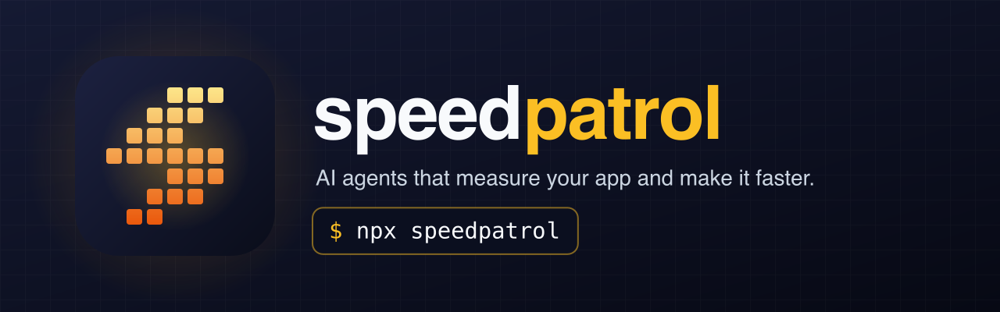
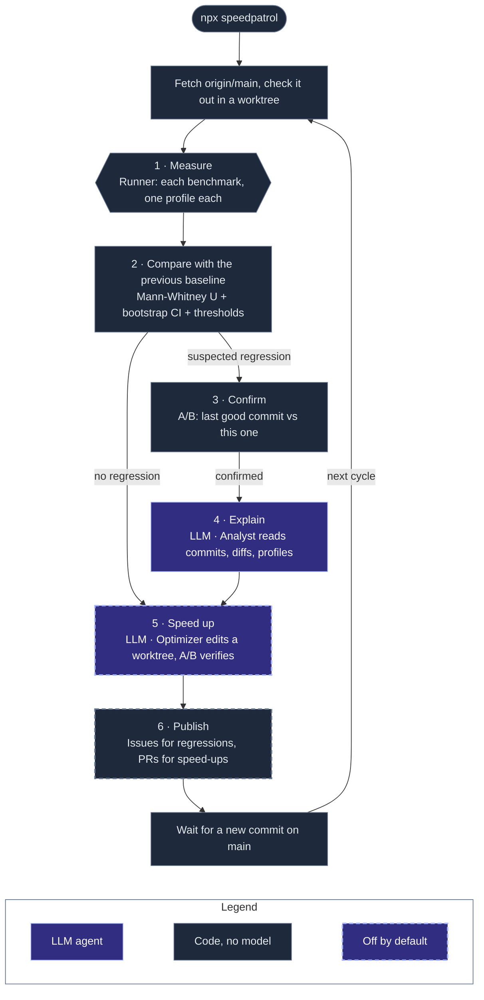
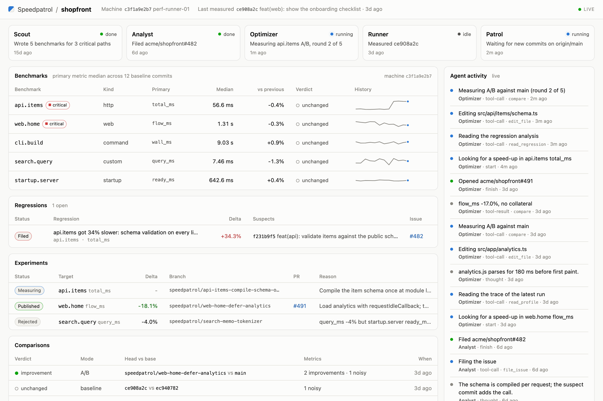

<p align="center">
  
</p>

<p align="center">
  <a href="https://www.npmjs.com/package/speedpatrol"></a>
  <a href="https://github.com/agent-labs-dev/speedpatrol/actions/workflows/ci.yml"></a>
  <a href="LICENSE"></a>
</p>

Speedpatrol is a performance team made of agents. It measures the critical paths of your app on each commit to `main`: API endpoints, app open, page loads, screen navigation, builds, and commands. It keeps a baseline of each run, finds regressions with statistics, explains them, and proposes speed-ups that it measured itself. It is the performance sibling of [Bugpatrol](https://github.com/agent-labs-dev/bugpatrol).

- The **scout** agent reads the repo and the app, finds the critical paths, and writes a benchmark for each one.
- The **runner** is code, not a model. It starts the app, measures each benchmark, and records the **baseline** of the commit.
- **Statistics** decide each verdict. A second A/B measurement must confirm each regression.
- The **analyst** agent explains each confirmed regression: the suspect commits, the code, and the CPU profile.
- The **optimizer** agent (off by default) tries a speed-up in its own git worktree. An A/B run must prove it.
- Speedpatrol **publishes** to GitHub: an issue for each regression, and a PR for each verified speed-up.

```bash
npx speedpatrol
```

`npx speedpatrol` runs the patrol: measure each new commit on `main`, compare, confirm, explain, speed up, and publish. Then it waits for the next commit.





The dashboard (`npx speedpatrol dashboard`) shows the status of the project first: the open regressions, what waits for you, and the next command. Then it shows the benchmark trends, the runs, the experiments, and each agent, live.

## Quickstart

Speedpatrol is on npm as [`speedpatrol`](https://www.npmjs.com/package/speedpatrol). The current release is **0.3.0** ([what's new](https://github.com/agent-labs-dev/speedpatrol/releases/tag/v0.3.0)). You need Node 22 or later and `git`. For `web` and `electron` benchmarks, install Chromium for Playwright once:

```bash
PLAYWRIGHT_SKIP_BROWSER_GC=1 npx -y playwright@1.64.1 install chromium
```

Then, in your repo:

```bash
npx speedpatrol@latest --version   # or pin it: npm install -D speedpatrol@0.3.0
npx speedpatrol init               # create .speedpatrol/ (--agent claude | codex | opencode)
npx speedpatrol doctor             # check the config, git, the tools your commands run, Chromium, the agent CLIs
npx speedpatrol scout              # the scout writes a benchmark for each critical path
npx speedpatrol run                # measure this checkout and record the baseline of its commit
npx speedpatrol compare            # A/B this working tree against origin/main
npx speedpatrol compare --pr 123   # A/B a GitHub pull request against its base branch (needs gh)
npx speedpatrol dashboard          # http://127.0.0.1:4321
npx speedpatrol                    # the patrol: each new commit on origin/main
```

After `init`, tell Speedpatrol how to install, build and start your app in `.speedpatrol/speedpatrol.yml`; [Getting started](docs/getting-started.md) covers that step. Exit codes: 0 ok, 1 regression, 2 config error, 4 could not measure. `run` exits 0 on a regression unless you pass `--fail-on-regression`; `compare` always exits 1 on one.

## What it measures

Each benchmark is one critical path. Its `kind` selects how it is measured:

| Kind | Critical path | Main metrics |
| --- | --- | --- |
| `http` | An API endpoint, optionally under concurrency | `total_ms`, `ttfb_ms`, `p95_ms`, `rps` |
| `web` | A page load in Chromium, then screen navigation steps | `lcp_ms`, `fcp_ms`, `tbt_ms`, `cls`, `step.<name>_ms`, `flow_ms` |
| `electron` | Desktop app open to the first window and screen, then steps | `window_ms`, `ready_ms`, page metrics, steps |
| `startup` | Cold start of a server or worker | `ready_ms` |
| `android`, `ios`, `maestro` | Mobile app open and screen journeys | `total_time_ms`, `launch_ms`, `flow_ms` |
| `command` | A build, a test run, a CLI command | `wall_ms`, `cpu_user_ms`, `max_rss_mb` |
| `custom` | Any script that prints `{"metrics": {...}}` | the metrics it declares |

Each run takes warmup iterations, then timed iterations, then one profiled iteration, so the profiler never slows a timed sample. A benchmark's primary metric decides its verdict; a slower secondary metric is reported as a trade-off. Speedpatrol does not record a run as a baseline when the machine was loaded or the primary metric was noisy (`--force-baseline` overrides this), and a critical benchmark that measured nothing fails the run. [Benchmarks and metrics](docs/benchmarks.md) lists every metric.

## Set up with your agent

1. Install the Speedpatrol skill in your repo:

   ```bash
   npx skills add agent-labs-dev/speedpatrol
   ```

2. Give this prompt to your agent:

   ```text
   Set up Speedpatrol for this repo.
   ```

If your agent cannot install skills, give it the skill URL:

```text
Read https://raw.githubusercontent.com/agent-labs-dev/speedpatrol/main/skills/speedpatrol/SKILL.md and set up Speedpatrol for this repo.
```

To set up by hand, read [Getting started](docs/getting-started.md).

## What is supported

| | Supported |
| --- | --- |
| Platforms | HTTP APIs, web pages (Chromium), Electron apps, server startup, Android, iOS simulators, Maestro flows, builds and CLI commands, custom scripts |
| Agent LLMs | Claude Code, Codex, OpenCode, or any agent CLI. API keys for OpenRouter, OpenAI, Anthropic, or a custom endpoint |
| GitHub | An issue for each regression, a PR for each speed-up, and an Action that posts an A/B table on each PR |
| Output | A dashboard, a Markdown or JSON comparison table, plain JSON data in `.speedpatrol/runs/`, and CPU profiles |

## Documentation

| Page | What it covers |
| --- | --- |
| [Getting started](docs/getting-started.md) | Set up with your agent or by hand |
| [Commands](docs/commands.md) | Each command, the patrol, and the two ways to compare |
| [Benchmarks and metrics](docs/benchmarks.md) | The benchmark kinds, their metrics, and the profiles |
| [Configuration](docs/configuration.md) | Each field of `speedpatrol.yml` |
| [How it works](docs/how-it-works.md) | The measurement protocol, the statistics, and the patrol cycle |
| [Agents](docs/agents.md) | The roles, the runtimes, and the tools |
| [Running a patrol](docs/running-a-patrol.md) | A patrol on one machine, day after day, and pinning a version |
| [Dashboard](docs/dashboard.md) | What the dashboard shows |
| [Troubleshooting](docs/troubleshooting.md) | Exit codes and common failures |
| [CI](docs/ci.md) | The GitHub Action for pull requests |
| [Data model](docs/data-model.md) | The files under `.speedpatrol/runs/` |
| [Decisions](docs/adr/) | Why Speedpatrol works this way |
| [Contributing](CONTRIBUTING.md) | Build, test, and release Speedpatrol |

## License

[Apache-2.0](LICENSE)

---

<p align="center">Made with ❤️ by the Nebula team.</p>
