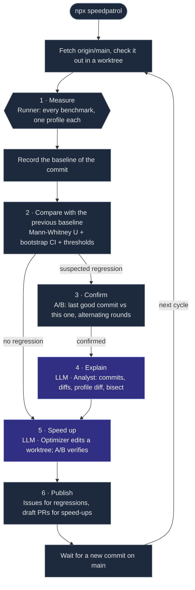

# Speedpatrol

Speedpatrol is a performance team made of agents. It measures the critical paths of your app on every commit to `main` — API endpoints, app open, page loads, screen navigation, builds and commands — keeps a baseline dataset of every run, catches regressions with statistics, explains them, and proposes speed-ups that it has measured itself.

It is the performance sibling of [Bugpatrol](https://github.com/agent-labs-dev/bugpatrol), and it is set up the same way: one `.speedpatrol/` folder, agent roles that run on any agent runtime, a patrol that runs all day, a dashboard, and GitHub issues and PRs.

- The **scout** reads the repo and the running app, finds the critical paths, and writes a benchmark for each one. It saves a benchmark only after it has run it.
- The **runner** is code, not a model. It brings the app up, measures every benchmark (warmup, timed iterations, then one profiled iteration), and records the run as the **baseline** of its commit.
- **Statistics** decide every verdict. A change is a regression only when a rank test and a bootstrap interval both say so, it clears the thresholds, and a second, independent A/B measurement confirms it.
- The **analyst** explains each confirmed regression: the suspect commits, the code, what the CPU profile shows. It can bisect with its own A/B runs. It cannot clear a verdict.
- The **optimizer** (off by default) tries a speed-up in its own git worktree. Speedpatrol keeps it only when an A/B run shows the target got faster and no critical path got slower.
- Speedpatrol **publishes** to GitHub: an issue for each regression, a draft PR for each verified speed-up.

```bash
npx speedpatrol
```

### How the patrol runs



- Every 30 minutes the patrol fetches `origin/main`. It measures only a commit it has not measured; on the same commit it still finishes open work (analysis, experiments, publishing).
- The patrol measures `main` in a detached worktree under `.speedpatrol/runs/checkouts/`, so it never touches the checkout you work in.
- When there are no benchmarks yet, the first cycle runs the scout.
- `npx speedpatrol --once` runs one cycle; `--force` measures the same commit again; `--no-optimize` skips the optimizer for that run, so `speedpatrol optimize` can run as its own step.

## Two ways to compare

**Against the baseline.** `speedpatrol run` measures this checkout, records it as the baseline of its commit when the tree is clean, and compares it with the newest baseline of another commit on this machine. Each patrol cycle does this for `main`, so the baselines form a history you can chart.

**A/B, for a change.** `speedpatrol compare` measures two checkouts on the same machine, in alternating rounds (A B, B A, ...), so a machine that drifts during the comparison affects both sides the same. Use it for a branch, a PR, or an improvement you are trying in a worktree:

```bash
speedpatrol compare                           # this working tree (with uncommitted changes) vs origin/main
speedpatrol compare --head ../my-worktree     # a worktree vs origin/main
speedpatrol compare --base v1.4.0 --head main # two refs
speedpatrol compare api.orders web.inbox      # only some benchmarks (ids or tags)
```

It prints a table and exits 1 when a primary metric regressed:

```
🔴 regression: `working tree` (a41c09d2) against `origin/main` (3f9a1c2e)

| Verdict        | Benchmark   | Metric   | Base (median) | Head (median) | Change | 95% CI           | p      |
| 🔴 regression  | api.orders  | total_ms | 41.2 ms       | 57.9 ms       | +40.5% | +35.1% to +46.0% | <0.001 |
| ⚪ unchanged   | web.inbox   | lcp_ms   | 812.0 ms      | 806.5 ms      | -0.7%  | -2.9% to +1.4%   | 0.512  |
```

## What it measures

| Kind | Critical path | Metrics |
| --- | --- | --- |
| `http` | An API endpoint, optionally under concurrency | `total_ms`, `ttfb_ms`, `bytes`, `p95_ms`, `rps` |
| `web` | A page load in Chromium, then screen navigation steps | `lcp_ms`, `fcp_ms`, `ttfb_ms`, `dcl_ms`, `load_ms`, `tbt_ms`, `cls`, `requests`, `transfer_kb`, `js_heap_mb`, `step.<name>_ms`, `flow_ms` |
| `electron` | Desktop app open to the first window and the first screen, then steps | `window_ms`, `ready_ms`, page metrics, steps |
| `startup` | Cold start of a server or worker until it prints a line or answers a URL | `ready_ms` |
| `android` | Cold app open (`am start -W`) | `total_time_ms`, `wait_time_ms` |
| `ios` | App open on a simulator, to a marker the app prints | `launch_ms` |
| `maestro` | A mobile screen journey (a Maestro flow) | `flow_ms` |
| `command` | A build, a test run, a CLI command | `wall_ms`, `cpu_user_ms`, `cpu_sys_ms`, `max_rss_mb` |
| `custom` | Any script that prints `{"metrics": {...}}` (k6, hyperfine, your own) | what it declares |

Web throttling (`cpuThrottle`, `network: 4g | fast-3g | slow-3g`) uses the Chrome DevTools presets.

**Profiles.** After the timed iterations, Speedpatrol takes one more iteration with a profiler on, so the profiler never slows a timed sample: a CDP CPU profile for `web` and `electron`, and a V8 `--cpu-prof` of every Node process for `command`, `startup` and `custom` (a server stopped by a signal still writes its profile). `profile.mode: command` wraps any profiler instead, e.g. `py-spy record -o {out} -- {cmd}`. Each profile is summarised into hotspots (self and total time per function), and the analyst and the optimizer read the diff of two profiles.

## Set up with your agent

1. Install the Speedpatrol skill in your repo:

   ```bash
   npx skills add agent-labs-dev/speedpatrol
   ```

2. Give this prompt to your agent:

   ```text
   Set up Speedpatrol for this repo.
   ```

The [skill](skills/speedpatrol/SKILL.md) tells the agent how to configure Speedpatrol for your app, prove the setup works, run the scout, and read the results.

## Set up by hand

You need Node 22 or later and `git`. For `web` and `electron` benchmarks, install Chromium for Playwright once:

```bash
PLAYWRIGHT_SKIP_BROWSER_GC=1 npx -y playwright@1.64.1 install chromium
```

1. Create the config:

   ```bash
   npx speedpatrol init            # --agent claude | codex | opencode
   ```

   ```text
   .speedpatrol/
     speedpatrol.yml   # the config: commit it
     instructions.md   # the app guide for the agents: commit it
     benchmarks.json   # the benchmarks the scout wrote: commit it
     runs/             # runs, baselines, comparisons, profiles, sessions: git ignores it
   ```

2. Tell Speedpatrol how to start your app in `app.setup` (and how to install and build it in `app.prepare`), and write `instructions.md`: what the app is and which paths users wait for.

3. Add benchmarks, or let the scout write them:

   ```bash
   npx speedpatrol scout
   ```

4. Measure, and start the patrol:

   ```bash
   npx speedpatrol run          # measure this checkout and record the baseline
   npx speedpatrol              # the patrol: every new commit on origin/main
   npx speedpatrol dashboard    # http://127.0.0.1:4321
   ```

A complete config is in [examples/fixture-app](examples/fixture-app/.speedpatrol/speedpatrol.yml), and every field is in [Configuration](docs/configuration.md).

## Any agent runtime

Each role runs on a local agent CLI or on an API key. The tools are the contract, not the runtime: a CLI agent gets the role's tools over a local MCP server, and Speedpatrol's own loop calls the same tools in-process.

```yaml
agents:
  scout: { use: claude }                                           # Claude Code
  analyst: { use: codex }                                          # Codex
  optimizer:
    enabled: true
    use: { runtime: model, via: openrouter, model: anthropic/claude-sonnet-5.5 }
```

`use: claude | codex | opencode` picks a preset command; `{ runtime: cli, command: "..." }` runs any command with `{prompt}`, `{mcp}`, `{mcpUrl}` and `{workdir}` filled in. [Agents](docs/agents.md) lists the tools of each role.

## Pull requests in CI

The Speedpatrol Action runs an A/B compare of the PR against its base branch and posts the table as a comment:

```yaml
# .github/workflows/speedpatrol.yml
name: Speedpatrol
on: pull_request
permissions:
  contents: read
  pull-requests: write
jobs:
  compare:
    runs-on: ubuntu-latest
    steps:
      - uses: actions/checkout@v4
        with: { fetch-depth: 0 }
      - uses: agent-labs-dev/speedpatrol@v0
        with:
          fail-on-regression: true
```

Hosted runners are noisy neighbours. The A/B rounds and the confirmation keep false alarms rare, but a dedicated runner gives tighter intervals. [CI](docs/ci.md) has the inputs.

## The dashboard

```bash
npx speedpatrol dashboard              # http://127.0.0.1:4321
```

The dashboard shows the trend of every benchmark across the baselines of `main`, the hotspots of the latest profile, every comparison, the regressions and the experiments, and what each agent is doing, live.

## Docs

- [How it works](docs/how-it-works.md): the measurement protocol, the statistics, the patrol cycle.
- [Configuration](docs/configuration.md): every field of `speedpatrol.yml`.
- [Data model](docs/data-model.md): the files under `.speedpatrol/runs/`.
- [Agents](docs/agents.md): roles, runtimes, tools.
- [CI](docs/ci.md): the GitHub Action.
- [Decisions](docs/adr/): why it works this way.

## Development

```bash
pnpm install
pnpm build
pnpm test        # real processes and a real Chromium: install it first
pnpm check
```

## License

Apache-2.0
