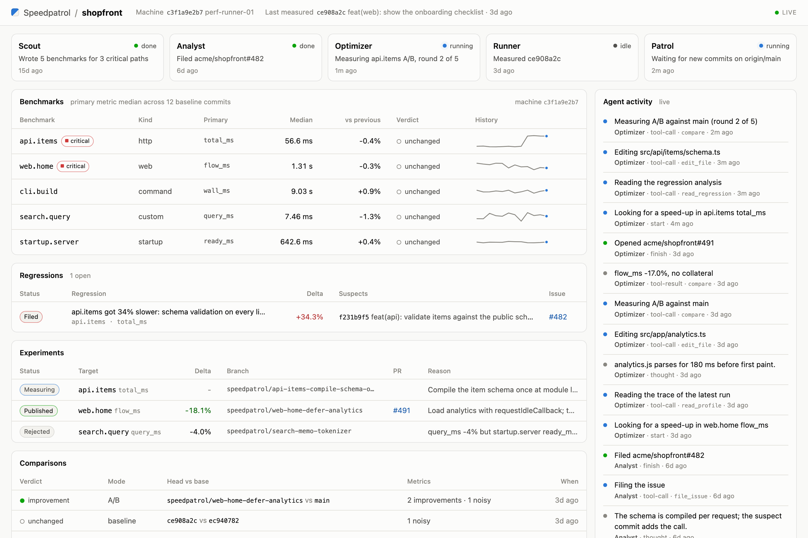

# The dashboard



Start the dashboard in the repo that has `.speedpatrol/`:

```bash
npx speedpatrol dashboard              # http://127.0.0.1:4321
npx speedpatrol dashboard --port 5000  # use a different port
```

The dashboard shows these items:

- The trend of each benchmark across the baselines of `main`.
- The hotspots of the latest profile.
- Each comparison.
- The regressions and the experiments.
- What each agent does, live.

The dashboard reads the files in `.speedpatrol/runs/` ([Data model](data-model.md)). So it works during a patrol and after it.
